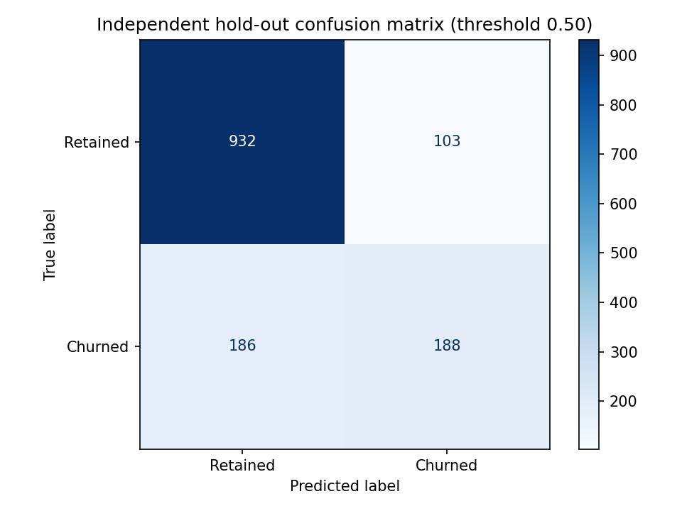
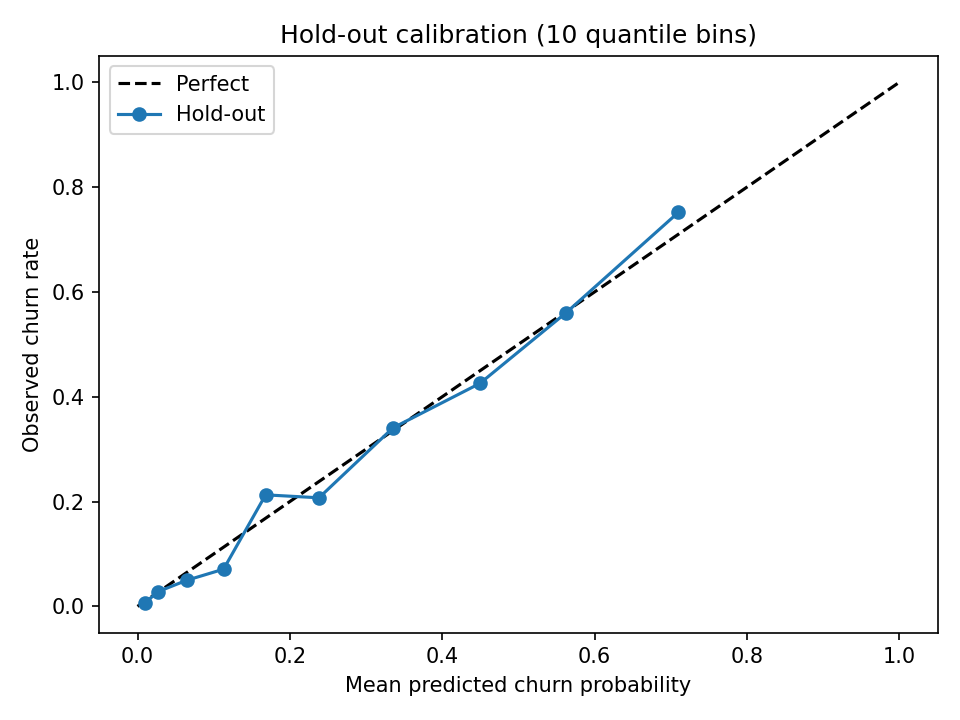
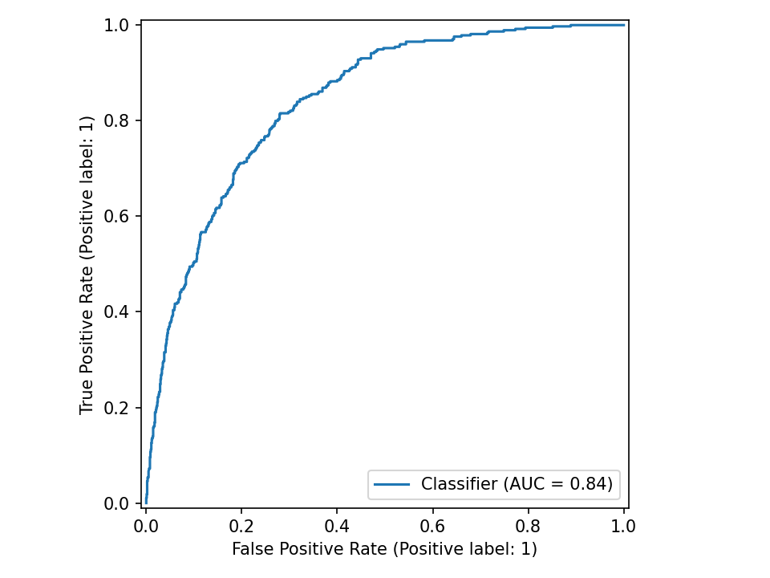
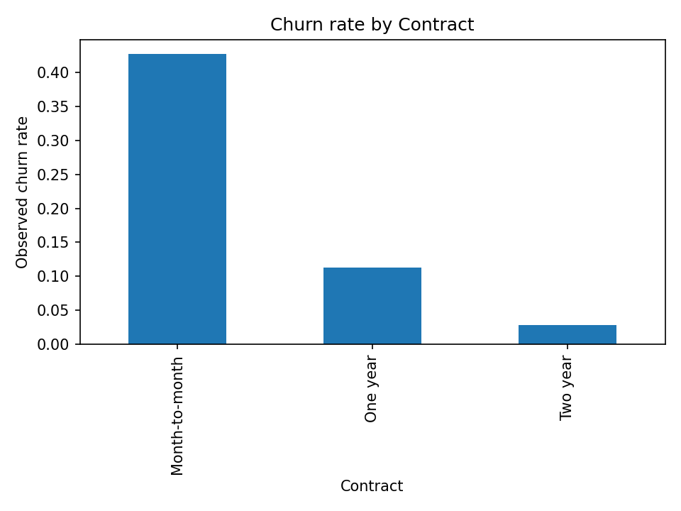

# Customer Churn & Retention Analytics
**Business Management × Data Science | Public IBM Telco sample**

> **Portfolio research, not operational telecom results.** The public IBM Telco sample represents a fictional company. Its billing figures are in original dataset units, **not South African rand**. The R-denominated retention examples below use entirely separate, explicitly assumed values.

## Executive summary
**Decision:** Which customers should a retention team contact, given limited budget, uncertain response rates and the cost of incentives?

- **7,043** sample customer records; **26.5%** churn.
- Three models compared by **five-fold stratified cross-validation on the development split**.
- **Random Forest** selected on development ROC-AUC (**0.846**).
- Independent 20% hold-out: **ROC-AUC 0.841**, **average precision 0.643**, **Brier 0.137**.
- The highest-risk 20% of hold-out customers capture **49.5%** of observed churners. This is retrospective ranking, **not** proof that contact prevents churn.
- In a *hypothetical* South African scenario with R1,000 monthly revenue, 30% contribution margin, six-month horizon, R150 outreach cost and 10% incremental retention uplift, contacting this group produces **approximately R10,000 negative net value**. The uplift is assumed, not measured.

## Business Management contribution
| Management question | Analytical evidence | Decision implication |
|---|---|---|
| Who is most at risk? | Hold-out ranking, segment churn rates | Prioritise research and targeted outreach |
| What are the main customer groups? | Contract, tenure, internet service and payment-method patterns | Tailor offers and service interventions |
| Does targeting create value? | R-denominated cost/uplift sensitivity scenarios | Do not fund a campaign on model accuracy alone |
| How should results be governed? | Calibration, confusion matrix, limitations | Human oversight, privacy and fairness review |

**Segment to investigate:** Month-to-month fibre-optic customers show elevated observed churn in this sample. This is **association, not evidence that changing contract or service causes retention**.

## Data Science contribution
- Data cleaning retains 11 missing `TotalCharges` values; imputation occurs **inside training folds**.
- Logistic Regression, Decision Tree and Random Forest compared using **development-only** cross-validation.
- Independent hold-out used only after model selection.
- ROC-AUC, average precision, confusion matrix, calibration curve and Brier score.
- `TotalCharges` excluded from the primary model because it is strongly tied to tenure and monthly charges and its availability at the scoring date may be ambiguous. An exploratory sensitivity check is included in `reports/correlated_feature_sensitivity.csv`.
- Risk associations and model coefficients are **not causal effects**.

## Figures





## Run
```bash
python -m pip install -r requirements.txt
python src/run_all.py
python -m unittest discover -s tests -v
```
Then open `notebooks/customer_churn_analysis.ipynb` to inspect the saved results and business interpretation.

## Files
- `src/`: cleaning, exploratory analysis, modelling, hypothetical retention economics and full pipeline.
- `reports/`: CV scores, hold-out metrics, calibration, ranked hold-out queue, segments and cost sensitivities.
- `visualisations/`: charts including confusion matrix and calibration.
- `notebooks/`: executed analytical walkthrough.
- `BUSINESS_ANALYSIS.md`: operational decisions, stakeholders, campaign economics and governance.
- `MODEL_CARD.md`: methodology, limitations and responsible use.
- `DATA_SOURCE.md`: dataset provenance and redistribution caution.

## Limitations
This is a fictional public sample, not a live South African customer portfolio. The model predicts historical churn association; it **does not estimate treatment effect or incremental retention**. Calibration is a diagnostic on one hold-out, not production certification. Financial scenarios are assumptions, not measured revenue or campaign ROI. No customer-level adverse action is recommended.

**Author:** Joston Mathabathe — BCom Business Management | Postgraduate Diploma in Data Science.
